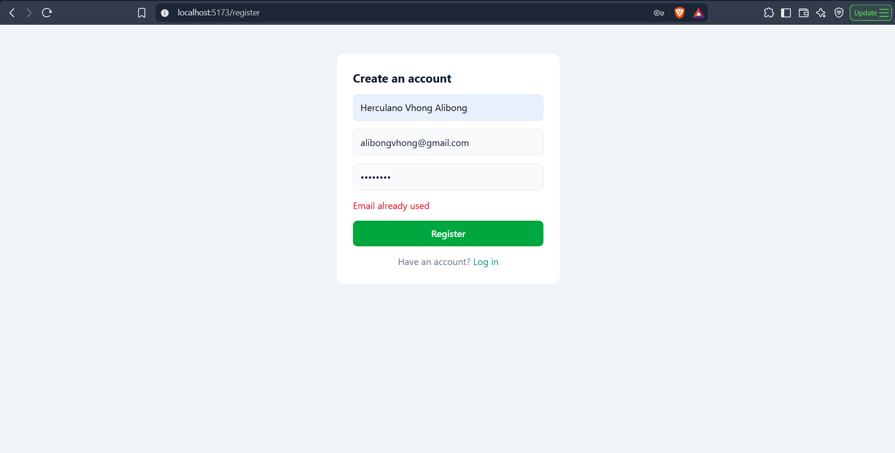
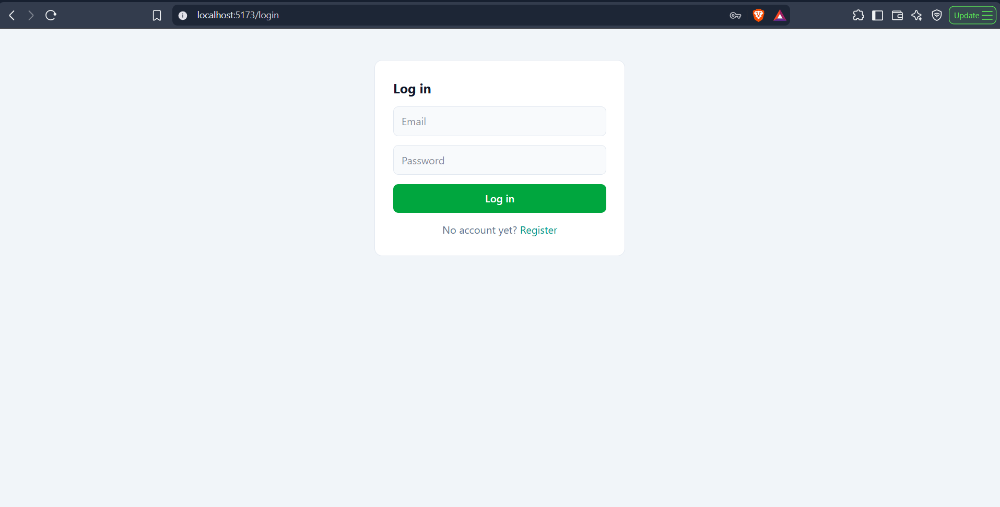
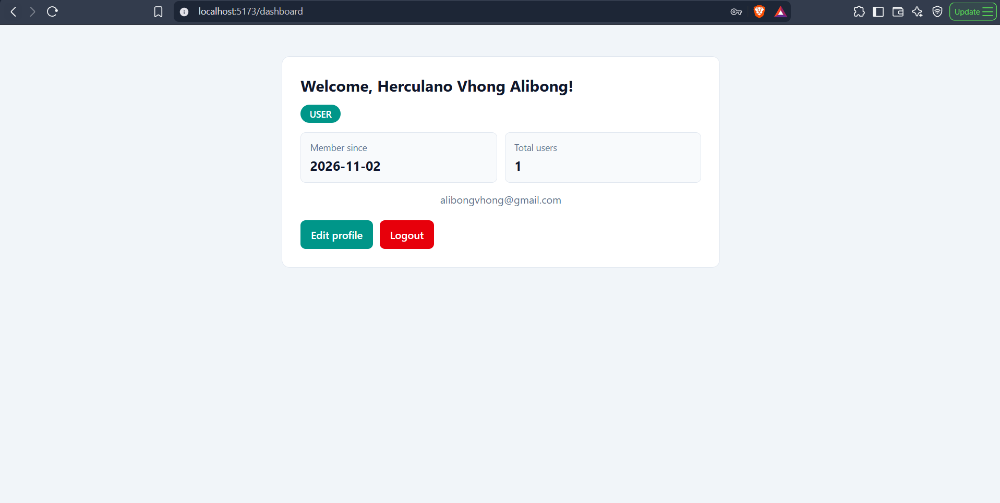
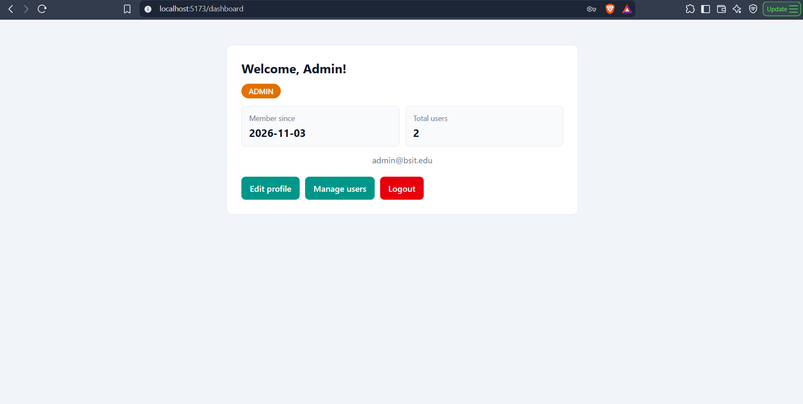
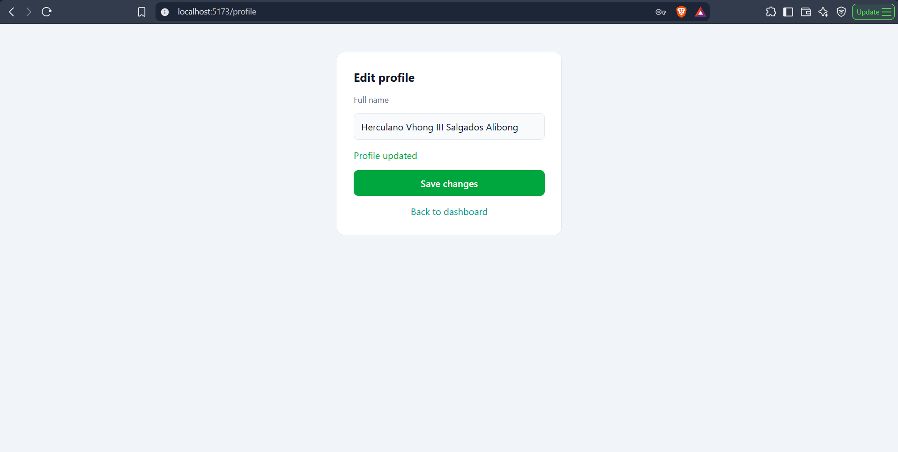

# UserHub: Full-Stack Web Application

UserHub is a user management web app built for the BSIT Full-Stack Lab. It supports
user registration, login with token-based authentication, role-based authorization
(USER and ADMIN), a protected dashboard, an admin-only user list, server-side logout,
and profile editing. The React frontend talks to a Spring Boot REST API, which stores
data in an H2 database.

## Technologies Used

| Layer    | Technology                                                                   |
| -------- | ---------------------------------------------------------------------------- |
| Frontend | React 19, TypeScript, Vite, React Router, Axios, Tailwind CSS                |
| Backend  | Java 21, Spring Boot 4.1.2, Spring Web MVC, Spring Data JPA, Bean Validation |
| Database | H2 (in-memory)                                                               |
| Tools    | Maven, Node.js, npm, Postman, VS Code                                        |

## System Requirements

- JDK 21 or higher (check with `java -version`)
- Node.js LTS (check with `node -v`)
- Git
- Maven is optional because the project includes the Maven Wrapper (`mvnw`)
- Postman (optional, for API testing)

## Project Structure

```
Lastname-Firstname-First-Web-App/
├── backend/     Spring Boot API
├── frontend/    React + Vite app
├── docs/        REQUIREMENTS.md and screenshots
└── README.md
```

## Application URLs and Ports

| Service         | URL                              |
| --------------- | -------------------------------- |
| React frontend  | http://localhost:5173            |
| Spring Boot API | http://localhost:8080            |
| H2 console      | http://localhost:8080/h2-console |

## Setup and Run

Clone the repository:

```bash
git clone https://github.com/theThird25/Alibong-HerculanoVhong-First-Web-App.git
cd Alibong-HerculanoVhong-First-Web-App
```

### 1. Backend (Terminal 1)

```bash
cd backend
.\mvnw.cmd spring-boot:run      # Windows (PowerShell)
./mvnw spring-boot:run          # macOS / Linux / Git Bash
```

Wait for `Tomcat started on port 8080`. Keep this terminal open.

### 2. Frontend (Terminal 2)

```bash
cd frontend
npm install
npm run dev
```

Open http://localhost:5173 in your browser.

Start the backend before the frontend.

## Default Admin Account

An ADMIN account is created automatically each time the backend starts:

| Email          | Password   |
| -------------- | ---------- |
| admin@bsit.edu | admin12345 |

This account is for local development only and must not be used in production.

## How to Test

### Using the web app

1. Open http://localhost:5173 and click **Register** to create an account.
2. Log in with that account to reach the dashboard.
3. Refresh the page. You should still be logged in.
4. Click **Edit profile**, change your full name, and save.
5. Click **Logout**, then open http://localhost:5173/dashboard directly. You should be sent to login.
6. Log in as `admin@bsit.edu`. A **Manage users** button appears and lists all users.
7. As a normal user, open http://localhost:5173/admin/users. You should be redirected to the dashboard.

### Using Postman

| #   | Request                                  | Body / Header                                                             | Expected          |
| --- | ---------------------------------------- | ------------------------------------------------------------------------- | ----------------- |
| 1   | POST /api/auth/register                  | `{"fullName":"Ana Cruz","email":"ana@bsit.edu","password":"password123"}` | 201 Created       |
| 2   | POST /api/auth/register (same email)     | same body                                                                 | 409 Conflict      |
| 3   | POST /api/auth/register (short password) | password under 8 chars                                                    | 400 Bad Request   |
| 4   | POST /api/auth/login                     | email and password                                                        | 200 OK with token |
| 5   | POST /api/auth/login (wrong password)    | wrong password                                                            | 401 Unauthorized  |
| 6   | GET /api/dashboard                       | no header                                                                 | 401 Unauthorized  |
| 7   | GET /api/dashboard                       | `Authorization: Bearer <token>`                                           | 200 OK            |
| 8   | GET /api/dashboard/users                 | normal user token                                                         | 403 Forbidden     |
| 9   | GET /api/dashboard/users                 | admin token                                                               | 200 OK            |
| 10  | PUT /api/users/me                        | token, `{"fullName":"New Name"}`                                          | 200 OK            |
| 11  | POST /api/auth/logout                    | token                                                                     | 204 No Content    |
| 12  | GET /api/dashboard                       | the same token after logout                                               | 401 Unauthorized  |

## Additional Configuration Notes

- **In-memory database:** H2 data and login sessions reset every time the backend restarts. Register again after a restart. The admin is re-created automatically.
- **CORS:** the backend only allows requests from `http://localhost:5173`. If Vite starts on a different port, stop the old Vite process and restart it.
- **H2 console:** use JDBC URL `jdbc:h2:mem:userhubdb`, user `sa`, and an empty password.
- **Java version:** the project targets Java 21 (`java.version` in `backend/pom.xml`). If you see a "release version not supported" or "class file version" error, run `.\mvnw.cmd clean spring-boot:run`.
- **Security note:** passwords use SHA-256 for learning purposes. A production app would use BCrypt, Spring Security with JWT, and HTTPS.

## Documentation

- Feature list: [docs/REQUIREMENTS.md](docs/REQUIREMENTS.md)
- Screenshots: [docs/screenshots/](docs/screenshots/)

## Screenshots

| Registration                                  | Login                                   |
| --------------------------------------------- | --------------------------------------- |
|  |  |

| Dashboard                                       | Admin Users                                         |
| ----------------------------------------------- | --------------------------------------------------- |
|  |  |

| Edit Profile                                          |
| ----------------------------------------------------- |
|  |

## Author

Alibong, Herculano Vhong III Salgados
